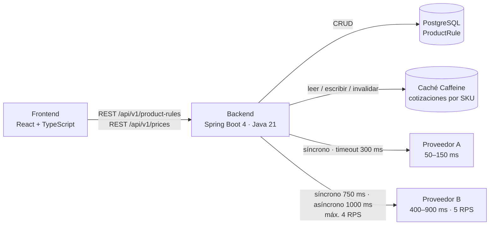
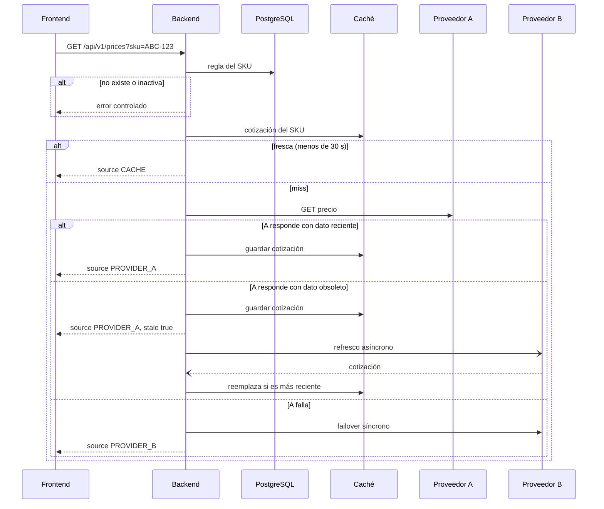

# Price Consolidation App

Middleware de consulta consolidada de precios. Administra reglas comerciales por SKU (margen, proveedor preferido, estado) y, al consultar un precio, integra en tiempo real a dos proveedores externos con caché, failover y control de tasa. Incluye una SPA para gestionar las reglas y simular consultas.

## Cómo ejecutarlo

Requisito: Docker con Compose v2. Java, Node y PostgreSQL corren dentro de las imágenes.

```bash
docker compose up --build
```

| Servicio | URL |
|---|---|
| Frontend | http://localhost:3000 |
| API | http://localhost:8080/api/v1 |
| Estado y circuitos | http://localhost:8080/actuator/health · http://localhost:8080/actuator/circuitbreakers |
| Proveedor A (stub) | http://localhost:9001 |
| Proveedor B (stub) | http://localhost:9002 |

La base arranca con cuatro reglas: `ABC-123` (`AUTO`), `XYZ-789` (`PROVIDER_A`), `LMN-456` (`PROVIDER_B`) y `OLD-001` (inactiva). Las credenciales de PostgreSQL tienen valores por defecto; para cambiarlas, copiar `.env.example` a `.env`.

| Método | Ruta | Respuestas |
|---|---|---|
| `POST` | `/api/v1/product-rules` | 201 · 400 validación · 409 SKU duplicado |
| `GET` | `/api/v1/product-rules` | 200 |
| `PUT` | `/api/v1/product-rules/{sku}` | 200 · 400 · 404. Invalida la caché del SKU |
| `DELETE` | `/api/v1/product-rules/{sku}` | 204 · 404. Borrado físico; para desactivar se usa `PUT` con `active: false`. Invalida la caché del SKU |
| `GET` | `/api/v1/prices?sku={id}` | 200 · 404 inexistente · 422 inactivo · 503 sin proveedores ni respaldo |

Los errores salen en formato ProblemDetail (RFC 9457) con un campo `code` estable y, en validaciones, `errors[]` por campo.

## 1. Diagrama end-to-end



Flujo de `GET /api/v1/prices?sku={id}` con `preferredProvider = AUTO`:



## 2. Estrategia de consulta y consolidación

Cada consulta sigue estos pasos:

1. Se busca la regla del SKU. Si no existe se responde 404 (`PRODUCT_RULE_NOT_FOUND`), y si está inactiva 422 (`SKU_INACTIVE`), sin tocar caché ni proveedores.
2. Si la caché tiene una cotización de menos de 30 s, se responde con `source: CACHE`.
3. Si no, se consulta según `preferredProvider`:

| `preferredProvider` | Primera llamada | Si responde con dato obsoleto | Si falla |
|---|---|---|---|
| `AUTO` | A, síncrono | Se responde con A y `stale: true`, y se refresca desde B en segundo plano | Failover síncrono a B |
| `PROVIDER_A` | A, síncrono | Se responde con A y `stale: true` | Failover síncrono a B |
| `PROVIDER_B` | B, síncrono | Se responde con B y `stale: true` | Failover síncrono a A |

"Falla" incluye error de conexión, 5xx, timeout, circuito abierto, bulkhead lleno o falta de permiso del limitador.

4. Si ambos proveedores fallan, se responde con la última cotización conocida (hasta 30 min de antigüedad) con `source: FALLBACK_CACHE` y `stale: true`. Si no hay ninguna, se responde 503 (`PROVIDERS_UNAVAILABLE`) en formato ProblemDetail con `Retry-After: 10`, el tiempo que un circuito pasa abierto. Nunca sale una excepción cruda.
5. `finalPrice = providerPrice × (1 + marginPercentage / 100)`, con el margen de la regla vigente al momento de responder, redondeado a 2 decimales con `HALF_UP`.

La respuesta es la del enunciado más un campo, `providerSource` (`PROVIDER_A` o `PROVIDER_B`). Con `source: CACHE` o `FALLBACK_CACHE` ese campo indica de qué proveedor vino el dato guardado. `responseTimeMs` mide el tiempo dentro del servicio: base de datos, caché y proveedores, sin la serialización JSON.

**Consolidación.** Cuando el refresco en segundo plano trae una cotización de B, reemplaza a la guardada solo si es más reciente según el instante que informa cada proveedor (`lastUpdated` en A, `timestamp` en B, epoch en segundos) y si está en la misma moneda. La frescura del dato decide, no la fuente. Una consulta síncrona (incluido el failover) obtiene una sola cotización y la guarda tal cual.

**Por qué cumple p95 < 800 ms.** El p95 es global: alcanza con que menos del 5 % de las peticiones pase de 800 ms.

- Acierto de caché: lectura en memoria, sin red.
- Miss de `AUTO` o `PROVIDER_A`: se paga solo la latencia de A, con p95 ≈ 145 ms. El 30 % de datos obsoletos de A no espera a B, porque el refresco va en segundo plano.
- Failover A → B: si A falla rápido (conexión o 5xx), el total es A + B ≤ 750 ms. Si A falla por timeout, el peor caso es 300 + 750 = 1050 ms, pero solo mientras el circuito de A sigue cerrado. Con 10 llamadas evaluadas y la mitad fallando se abre, A se salta sin esperar y el failover queda en ≤ 750 ms.
- Miss de `PROVIDER_B`: B tiene un timeout de 750 ms en la ruta síncrona, lo que corta el 30 % de sus llamadas (B tarda 400–900 ms). En ese 30 %, el failover a A suma hasta 300 ms. El p95 se mantiene mientras los misses de SKUs `PROVIDER_B` sean menos del ~16 % del tráfico (0,3 × 16 % ≈ 5 %). Con TTL de 30 s y ráfagas del mismo SKU, la gran mayoría de las peticiones son aciertos de caché.

**Medición.** Con k6 dentro de la red del compose (`load-test/prices.js`), 60 s por perfil, midiendo solo `GET /api/v1/prices`:

| Perfil | Tráfico | p95 | Errores |
|---|---|---|---|
| Ráfagas sobre SKUs repetidos | 200 consultas/s sobre 3 SKUs | 2,7 ms | 0 de ~12 000 |
| Mezcla con misses | 200 consultas/s sobre 50 SKUs (`AUTO`, `PROVIDER_A`, `PROVIDER_B`) | 2,8 ms | 0 de ~12 100 |
| Peor caso | 10 consultas/s, todas misses de SKUs `PROVIDER_B` distintos | 861–875 ms | 0 de 600 |

El peor caso supera los 800 ms tal como se calculó arriba: el 100 % del tráfico son misses de `PROVIDER_B`, muy por encima del ~16 % que el diseño tolera. Es el límite conocido de la estrategia, no un fallo: ninguna consulta terminó en error.

## 3. Caché e invalidación

| Aspecto | Valor |
|---|---|
| Tecnología | Caffeine, en memoria del backend |
| Qué se guarda | La cotización normalizada: precio del proveedor, moneda, instante informado por el proveedor, proveedor de origen e instante en que se obtuvo |
| Qué no se guarda | El margen ni el precio final. Se calculan al responder con la regla vigente |
| Clave | `sku` |
| TTL fresco | 30 s desde que se obtuvo la cotización |
| Retención de respaldo | 30 min. Pasado el TTL fresco, la entrada sigue disponible solo como `FALLBACK_CACHE` |
| `stale` | Se calcula en cada respuesta: `ahora − instante del proveedor > 15 min`, con un reloj inyectable |

**Invalidación desde el CRUD.** `PUT /api/v1/product-rules/{sku}` y `DELETE /api/v1/product-rules/{sku}` borran la entrada de ese SKU. Esto incluye el dato de respaldo, porque es una sola entrada. La siguiente consulta vuelve a los proveedores con la regla nueva. Como el margen no está en la caché, si un refresco que ya estaba en vuelo escribe después de la invalidación, solo deja una cotización válida: el precio final siempre sale con el margen actual.

**Ráfagas del mismo SKU.** Los misses simultáneos de un SKU comparten una única carga (single-flight): la primera petición registra su carga en un mapa por SKU y las demás esperan ese mismo resultado. No se usa `AsyncCache.get` de Caffeine porque solo carga cuando la clave no existe, y aquí la entrada sigue presente 30 min como respaldo aunque ya no esté fresca. Una ráfaga de 50 peticiones genera 1 llamada a A y, como máximo, 1 refresco a B.

**Por qué en memoria y no Redis.** El sistema corre en una sola instancia. Caffeine responde sin red, y en las pruebas el tiempo se controla sin esperas. Con varias instancias, la invalidación tendría que ser compartida y habría que pasar a Redis.

**Capacidad.** Con `AUTO`, B recibe refrescos solo por el ~30 % de datos obsoletos: 0,3 × N / 30 s peticiones por segundo para N SKUs activos. Con el límite de 4 RPS (sección 5), alcanza para unos 400 SKUs activos a la vez.

## 4. Resiliencia

| Mecanismo | Proveedor A | Proveedor B |
|---|---|---|
| Timeout de conexión | 100 ms | 200 ms |
| Timeout de lectura | 300 ms | 750 ms síncrono · 1000 ms asíncrono |
| Reintentos | 1, con backoff de 50 ms + jitter, solo ante error de conexión o 5xx | Ninguno |
| Circuit breaker | Ventana de 20 llamadas, mínimo 10. Abre con 50 % de fallos o 80 % de llamadas lentas (> 250 ms). 10 s abierto, 3 llamadas en semiabierto | Igual, con llamada lenta > 900 ms. No cuenta sus timeouts síncronos de 750 ms |
| Bulkhead (semáforo) | 50 concurrentes, sin espera | 10 concurrentes, sin espera |

Por qué estos valores:

- **Timeouts.** A tiene el doble de su latencia máxima. B tiene dos plazos: cuando el usuario espera, 750 ms protege el p95 aunque corte el 30 % de las llamadas; en el refresco asíncrono nadie espera, así que 1000 ms no corta ninguna.
- **Reintentos.** Reintentar después de un timeout de 300 ms rompería el p95, por eso A reintenta solo ante fallos rápidos. B no reintenta porque cada intento gasta cupo del límite de 5 RPS. El failover al otro proveedor cumple el papel de segundo intento.
- **Circuit breaker.** Con tráfico alto, 20 llamadas se juntan en menos de un segundo, así que una caída se detecta casi enseguida. Cada 10 s se prueba si el proveedor volvió. El umbral de lentitud de B (900 ms) es su máximo normal, para que su lentitud propia no abra el circuito. En B, el circuito ignora los timeouts de la ruta síncrona: ese corte de 750 ms es una decisión nuestra que afecta a ~30 % de llamadas sanas. Si contaran, una ventana de 20 llamadas llegaría al 50 % de fallos por azar (≈ 4,8 % de probabilidad en cada evaluación) y el circuito se abriría sin que B estuviera caído; se observó en la prueba de carga antes de este ajuste. Siguen contando los 5xx, los errores de conexión y los timeouts del refresco en segundo plano.
- **Bulkhead.** Con hilos virtuales, un semáforo alcanza para aislar. B tiene unas 5 llamadas en vuelo (4–5 RPS × ~0,9 s), y el límite de 10 deja margen. Sin cupo no se hace cola: se pasa al failover o a la caché.

## 5. Rate limit del Proveedor B

- El límite se controla en el backend, antes de llamar a B: **1 permiso cada 250 ms**, es decir, 4 RPS repartidos sin ráfagas. Como no sabemos cómo mide B su ventana, el reparto parejo garantiza que nunca reciba más de 5 en un segundo. A cambio, se deja sin usar el 20 % del cupo.
- **Ruta síncrona** (failover y `PROVIDER_B`): si no hay permiso, no se espera. Se sigue de inmediato con el otro proveedor o con la caché. El p95 no depende del limitador.
- **Refresco asíncrono:** espera hasta 1 s por un permiso. Si no llega, el refresco se descarta y el siguiente miss lo vuelve a intentar.
- **429 recibido:** las llamadas a B se pausan 1 s, o lo que indique `Retry-After`. Recibir un 429 es la excepción, no el mecanismo de control.
- La deduplicación por SKU (sección 3) evita que una ráfaga del mismo SKU gaste más de un permiso.

## Pruebas

```bash
cd backend && ./mvnw test
```

Requiere Java 21 y Docker (Testcontainers levanta PostgreSQL 18). Son 69 pruebas sin `Thread.sleep`: el tiempo avanza con un reloj controlado, los proveedores se simulan con WireMock y el refresco en segundo plano corre en el mismo hilo.

| Caso pedido | Prueba |
|---|---|
| Acierto de caché e invalidación por `PUT` | `PriceQueryIntegrationTest.servesRepeatedQueryFromCacheAndRecalculatesAfterMarginUpdate` |
| Proveedor A caído → failover a B | `PriceQueryIntegrationTest.failsOverToProviderBWhenProviderAIsDown` |
| Ambos caídos → respuesta degradada | `PriceQueryIntegrationTest.servesFallbackCacheWhenBothProvidersAreDown` y `answersWithControlledErrorWhenBothProvidersAreDownAndNothingIsCached` |
| Expiración del TTL | `PriceQueryIntegrationTest.queriesProviderAgainOnceTheTtlExpires` |
| Circuit breaker | `PriceQueryIntegrationTest.opensProviderACircuitAndStopsCallingIt` |
| Rate limit de B | `ProviderBRateLimitIntegrationTest.neverSendsMoreThanFiveRequestsPerSecondToProviderB` |

Prueba de carga, con el sistema levantado (`PROFILE` = `hot`, `mixed` o `worst`):

```bash
docker run --rm --network price-consolidation-app_default \
  -v "$PWD/load-test:/scripts:ro" -e PROFILE=mixed \
  grafana/k6:2.3.0 run /scripts/prices.js
```

Se ejecuta dentro de la red del compose: desde el host, el reenvío de puertos de Docker Desktop agregó cortes de conexión de 30 s que no venían del backend.

## Escenarios a mano

Los stubs aceptan `POST /__control` con `{"mode": "up" | "down" | "timeout" | "error"}` y cambian de comportamiento sin reiniciarse. `down` responde 503, `error` 500 y `timeout` no responde en 10 s.

```bash
curl -X POST localhost:9001/__control -H 'Content-Type: application/json' -d '{"mode":"down"}'
```

| Escenario | Pasos | Resultado |
|---|---|---|
| Caché | Consultar `ABC-123` dos veces | `PROVIDER_A` y luego `CACHE` |
| Dato obsoleto de A | Consultar `ABC-123` hasta ver `stale: true` y repetir pasado 1 s | `CACHE` con `providerSource: PROVIDER_B` |
| Failover | A en `down`, consultar `XYZ-789` | `PROVIDER_B` |
| Respaldo | Consultar `LMN-456`, esperar 30 s, A y B en `down`, consultar | `FALLBACK_CACHE` con `stale: true` |
| Sin proveedores ni respaldo | A y B en `down`, crear una regla nueva y consultarla | 503 `PROVIDERS_UNAVAILABLE` |
| SKU inactivo | Consultar `OLD-001` | 422 `SKU_INACTIVE` |
| Invalidación | Consultar `ABC-123`, editar su margen, consultar | Precio recalculado con la fuente del proveedor, no `CACHE` |

Todos se pueden repetir desde la UI: el panel «Consultar precio» acepta cualquier SKU.
